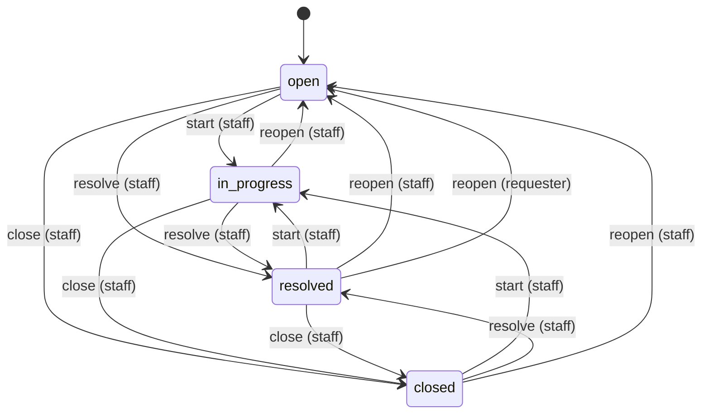
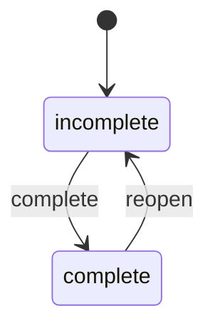
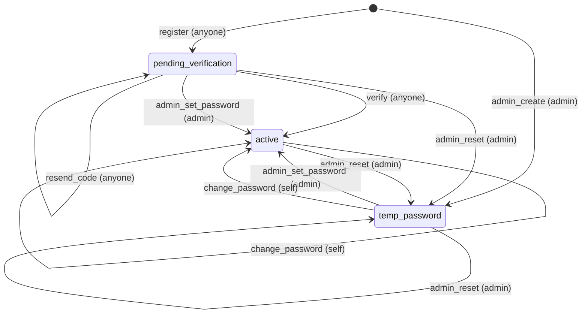
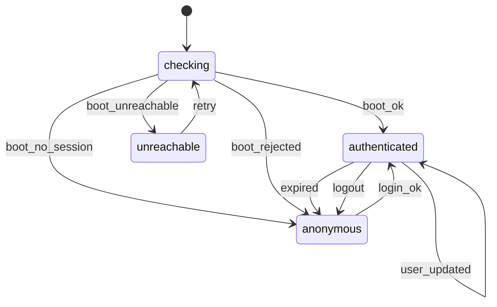

# State machines in this app

A *state machine* is any piece of data that moves through named stages with rules about which moves are allowed
(a ticket going from **open** to **resolved**, an account going from **unverified** to **active**, a browser going from
**signed in** to **signed out**). Every app has them; this one had about twenty, all *implicit* — encoded as strings,
booleans and `if`s spread across many files.

This document lists all of them, says which ones are now **explicit** (defined once in `shared/`, used by the server
and the browser, covered by tests) and which are deliberately left as plain UI flags.

> **Rule for contributors and AI agents:** never write a status, role or account-state string literal to make a
> decision. Ask the machine (`ticketStatus.transition(...)`, `canManageRole(...)`, `accountState(...)`, ...).
> Changed a machine? Run `npm run machines:docs` and `npm run check`.

## 1. Inventory — every implicit state machine found

### Domain lifecycles (enforced by the server)

| # | Machine | States | Where it was scattered | Now |
|---|---|---|---|---|
| 1 | **Ticket status** | open → in_progress → resolved → closed, plus reopening | `routes/tickets.js` (PATCH ×3 places, create, rating), `lib/meta.js`, `TicketPanel`, `TicketsWorkspace`, `Dashboard` | **Explicit** — `shared/ticketStatus.js` |
| 2 | **Account lifecycle** | pending_verification · temp_password · active (stored as two booleans, `verified` + `must_change_password`) | `routes/auth.js`, `routes/users.js`, App's password gate, People badges | **Explicit** — `shared/account.js` |
| 3 | **Role assignment policy** | owner > admin > manager > requestor; who may create / change / reset / delete whom | duplicated in `server/auth.js`, `routes/users.js`, `AuthContext.jsx`, `PeopleSettings.jsx` | **Explicit** — `shared/roles.js` |
| 3b | **Project task completion** | incomplete ⇄ complete (with dependency guard and recurrence effect) | new in Projects | **Explicit** — `shared/taskState.js` |
| 4 | Session token validity | valid → invalid when the password changes or is reset (`pv` claim vs `password_changed_at`) | `server/auth.js` | Documented (part of #2: `change_password`, `admin_reset`, `admin_set_password` end all sessions) |
| 5 | Subtask | open ⇄ done (`done` + `done_at`) | `routes/tickets.js` | Documented — too small to need a machine |
| 6 | Rating | unrated → rated, once; only the requester, only on a done ticket | `routes/tickets.js` | Documented; "done" now comes from #1 |
| 7 | Priority → due date | changing priority recomputes the due date unless one is sent | `routes/tickets.js`, `server/sla.js` | Documented |
| 8 | Message visibility | public ⇄ internal (staff-only) | `routes/tickets.js` | Documented |
| 9 | Assignment | unassigned → auto-routed on create → reassigned by staff | `routes/tickets.js` (`autoAssign`) | Documented |
| 10 | Server boot | schema → migrations (agent→manager, first admin→owner) → seed if empty → listen; exit 1 on failure | `server/db.js`, `server/index.js` | Documented |
| 11 | Email delivery mode | Resend API → SMTP → Ethereal test inbox, chosen by environment variables | `server/email.js` | Documented |

### Browser (React)

| # | Machine | States | Now |
|---|---|---|---|
| 12 | **Sign-in session** | checking → anonymous · authenticated · **unreachable**; authenticated → **expired** → anonymous | **Explicit** — `shared/session.js` + `src/lib/session.js` |
| 13 | Sign-in screens | login ⇄ register → verify; plus the forced "set your password" gate | Documented (the gate is driven by #2) |
| 14 | App shell navigation | page × selected ticket × "new ticket" dialog × "change password" dialog | Documented; state now resets whenever a different person signs in |
| 15 | Tickets workspace | list ⇄ board, selection, filters; optimistic edit → saved or rolled back | Documented |
| 16 | Ticket panel | loading → ready / error, plus independent flags (sending, uploading, adding subtask, preview open, tab) | Documented — these flags are *independent*, not one machine |
| 17 | Attachment preview | loading → ready / no-preview / error | Documented (it already used an explicit `status` field) |
| 18 | People page | tab, three dialogs, one-time credentials notice, reset-form mode | Documented |
| 19 | New-ticket form | editing → creating → uploading attachments → closed (a failed upload does not undo the ticket) | Documented |
| 20 | Small toggles | due-date cell display ⇄ edit, subtask input, comment composer sending | Documented |

**Why only #1, #2, #3 and #12 became code.** They carry business rules or had real gaps, and they are used by more than
one file (often by both server and browser). The rest are local UI flags or single-field toggles: turning them into
formal machines would add code and regression risk for no benefit. The best next candidate is #14 (App shell) if its
combination of flags ever starts causing bugs.

## 2. What auditing them turned up

| | Problem | Resolution |
|---|---|---|
| F1 | The API accepted **any** string as a ticket status; an empty or null status caused a database error (HTTP 500). | Status is validated by the machine; invalid values get **400** with the list of valid ones. |
| F2 | The activity log row was written **before** the ticket update, in separate queries — a failed update left a log entry for a change that never happened. | The update and its log rows are written in **one transaction**. |
| F3 | Closing a ticket that was never "resolved" left `resolved_at` empty. | `close` now stamps it if missing (`stamp_resolved_at_if_missing`). |
| F4 | "What counts as done" and the legal status moves were repeated in ~10 places. | One definition: `shared/ticketStatus.js`. |
| F5 | The browser session had no *ended* or *unreachable* state. A session killed by a password reset left a half-working signed-in screen; a server hiccup at startup **deleted the saved token and signed everyone out**. | Session machine: a rejected session returns to sign-in with an explanation; an unreachable server shows **Retry** and keeps the token. |
| F6 | Page, open ticket and dialogs leaked to the next person who signed in on the same browser tab. | The shell is keyed by the signed-in person, so it starts clean. |
| F7 | Role policy was duplicated on server and client and could drift. | One definition: `shared/roles.js`. |
| F8 | The UI recognised "unverified" by comparing **error text**. | The server now also sends a `code` field; the old text still works. |

**Behaviour that changed** (everything else is identical and covered by the tests): invalid status → 400 instead of being
stored or crashing (F1); closing from open/in-progress now sets `resolved_at` (F3); the session UX in F5 and F6.

## 3. Using the machines

```js
import { ticketStatus, ticketActor, completeToggleTarget } from '../shared/ticketStatus.js'

const actor = ticketActor(user, ticket)                 // { caps: ['staff'] } | { caps: ['requester'] } | { caps: [] }
ticketStatus.transition(ticket.status, 'resolved', actor)
//   → { ok: true, event: 'resolve', effects: ['stamp_resolved_at', 'notify_requestor_resolved'] }
//   → { ok: false, reason: 'unknown_state' | 'same_state' | 'not_allowed', allowed: ['open', ...] }
ticketStatus.targets(ticket.status, actor)              // what to offer in a dropdown / which board columns accept a drop
ticketStatus.can(ticket.status, 'reopen', actor)        // should the "Reopen" button show?
```

* **Effects are names, not actions.** The machine says *what must happen* (`stamp_resolved_at`, `notify_requestor_resolved`);
  `server/routes/tickets.js` performs them.
* **No actor means "already authorised".** Only pass none for transitions a route guard (`requireAdmin`...) has checked.
* **API:** `GET /api/machines` returns every machine and the role policy as JSON (sign-in required). Refused status changes
  return `{ error, code: 'invalid_status' | 'invalid_transition', from, to, allowed }`.

### Adding or changing a transition

1. Edit the machine in `shared/` (add the rule, its `caps`, and any `effects`).
2. If you added an effect, implement it where the server applies effects (`resolvedAtChange` / the email calls in `routes/tickets.js`).
3. Add a case to the matching test in `tests/`.
4. `npm run machines:docs` to regenerate the diagrams below, then `npm run check`.

## 4. Generated reference

<!-- BEGIN GENERATED (do not edit by hand — run `npm run machines:docs`) -->

### Ticket status

Source: `shared/ticketStatus.js` · Lifecycle of a ticket: open → in progress → resolved → closed, with reopening.



| State | Meaning | done |
|---|---|---|
| `open` | Open | false |
| `in_progress` | In progress | false |
| `resolved` | Resolved | true |
| `closed` | Closed | true |

| Event | From | To | Who | Effects | Note |
|---|---|---|---|---|---|
| `start` | `open`, `resolved`, `closed` | `in_progress` | staff | `clear_resolved_at` |  |
| `resolve` | `open`, `in_progress`, `closed` | `resolved` | staff | `stamp_resolved_at`, `notify_requestor_resolved` |  |
| `close` | `open`, `in_progress`, `resolved` | `closed` | staff | `stamp_resolved_at_if_missing` |  |
| `reopen` | `in_progress`, `resolved`, `closed` | `open` | staff | `clear_resolved_at` |  |
| `reopen` | `resolved` | `open` | requester | `clear_resolved_at`, `notify_assignee_reopened` | A requestor can only reopen their own resolved ticket. |

### Project task completion

Source: `shared/taskState.js` · Complete / incomplete lifecycle of a project task. Workflow stages are sections, not statuses.



| State | Meaning | done |
|---|---|---|
| `incomplete` | Incomplete | false |
| `complete` | Complete | true |

| Event | From | To | Who | Effects | Note |
|---|---|---|---|---|---|
| `complete` | `incomplete` | `complete` | anyone | `stamp_completed_at`, `spawn_next_occurrence` | Blocked while any task it depends on is still incomplete. A recurring task spawns its next occurrence. |
| `reopen` | `complete` | `incomplete` | anyone | `clear_completed_at` | Does not undo a spawned recurrence. |

### Account lifecycle

Source: `shared/account.js` · Sign-up, email verification and temporary-password lifecycle of a user account.



| State | Meaning | canLogin | verified | mustChangePassword |
|---|---|---|---|---|
| `pending_verification` | Awaiting email verification | false | false | false |
| `temp_password` | Temporary password | true | true | true |
| `active` | Active | true | true | false |

| Event | From | To | Who | Effects | Note |
|---|---|---|---|---|---|
| `register` | *(new)*, `pending_verification` | `pending_verification` | anyone | — | Registering an email that is still unverified replaces the name, password and code. |
| `resend_code` | `pending_verification` | `pending_verification` | anyone | — |  |
| `verify` | `pending_verification` | `active` | anyone | — | Needs the 6-digit code. |
| `admin_create` | *(new)* | `temp_password` | admin | — | Admin-created accounts start verified, with a temporary password. |
| `admin_reset` | `pending_verification`, `temp_password`, `active` | `temp_password` | admin | — | Also marks the email verified and signs the user out everywhere. |
| `admin_set_password` | `pending_verification`, `temp_password`, `active` | `active` | admin | — | Reset without forcing a change. Also verifies the email and signs the user out everywhere. |
| `change_password` | `temp_password`, `active` | `active` | self | — | Signs out all other sessions. |

### Role assignment policy

Source: `shared/roles.js` · Owner > Admin > Manager > Requestor. Also guarded in `server/routes/users.js`: nobody changes or deletes their own account, and the last Owner cannot be removed.

| Role | Works tickets (staff) | Admin-level | May manage | May assign |
|---|---|---|---|---|
| `owner` | yes | yes | `owner`, `admin`, `manager`, `requestor` | `owner`, `admin`, `manager`, `requestor` |
| `admin` | yes | yes | `manager`, `requestor` | `manager`, `requestor` |
| `manager` | yes | no | `requestor` | `requestor` |
| `requestor` | no | no | — | — |

### Admin access

Admins work tickets like Managers. Adding or changing accounts belongs to the **Owner, and Admins in IT Support** (IT Support is department `dept-it`). IT and the Owner also switch these on per Admin (they hold them by default): **Tickets of other departments** (`tickets`), **Departments & routing** (`departments`), **Customer ratings** (`ratings`). Ticket scope: an Admin outside IT Support sees only tickets of their own department plus tickets assigned to them, unless **Tickets of other departments** is on; Managers, IT and the Owner see all tickets. Admins have full access only to projects they created or were added to; the Owner sees every project.

### Browser session

Source: `shared/session.js` · Whether this browser is signed in, and what happens when the server says otherwise.



| State | Meaning |
|---|---|
| `checking` | Checking saved sign-in |
| `anonymous` | Signed out |
| `authenticated` | Signed in |
| `unreachable` | Server unreachable |

| Event | From | To | Who | Effects | Note |
|---|---|---|---|---|---|
| `boot_ok` | `checking` | `authenticated` | anyone | — |  |
| `boot_no_session` | `checking` | `anonymous` | anyone | — | No saved token. |
| `boot_rejected` | `checking` | `anonymous` | anyone | `clear_token`, `show_expired_notice` | Saved token refused (401). |
| `boot_unreachable` | `checking` | `unreachable` | anyone | — | Network error or 5xx. Token is kept. |
| `retry` | `unreachable` | `checking` | anyone | — |  |
| `login_ok` | `anonymous` | `authenticated` | anyone | `store_token` |  |
| `user_updated` | `authenticated` | `authenticated` | anyone | `store_token` | e.g. fresh token after a password change. |
| `expired` | `authenticated` | `anonymous` | anyone | `clear_token`, `show_expired_notice` | Server rejected our token mid-session. |
| `logout` | `authenticated` | `anonymous` | anyone | `clear_token` |  |

<!-- END GENERATED -->
